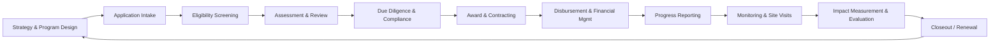

<!-- model: nvidia/nemotron-3-ultra-550b-a55b:free | category: text | run: 20261020T182045Z -->
<!-- PROMPT -->
Write an in-depth, approximately 1000-line article on how grant management software streamlines the full grant lifecycle for funders and grantees: application intake, assessment, disbursement, reporting, and impact measurement. Use headings, examples, and a feature comparison framework.
<!-- RESPONSE -->
# The Architecture of Impact: How Grant Management Software Streamlines the Full Grant Lifecycle

## Table of Contents
1.  [Executive Summary: The Shift from Administration to Strategy](#1-executive-summary-the-shift-from-administration-to-strategy)
2.  [The Anatomy of the Grant Lifecycle: A Primer](#2-the-anatomy-of-the-grant-lifecycle-a-primer)
3.  [Phase 1: Application Intake – Building the Digital Front Door](#3-phase-1-application-intake--building-the-digital-front-door)
4.  [Phase 2: Assessment & Review – Orchestrating Fairness and Rigor](#4-phase-2-assessment--review--orchestrating-fairness-and-rigor)
5.  [Phase 3: Award & Disbursement – Financial Precision and Compliance](#5-phase-3-award--disbursement--financial-precision-and-compliance)
6.  [Phase 4: Reporting & Monitoring – From Burden to Insight](#6-phase-4-reporting--monitoring--from-burden-to-insight)
7.  [Phase 5: Impact Measurement – Closing the Loop on Mission](#7-phase-5-impact-measurement--closing-the-loop-on-mission)
8.  [The Grantee Experience: Why Portal Usability Determines Data Quality](#8-the-grantee-experience-why-portal-usability-determines-data-quality)
9.  [Feature Comparison Framework: Evaluating GMS Platforms](#9-feature-comparison-framework-evaluating-gms-platforms)
10. [Implementation Strategy: Change Management and Data Migration](#10-implementation-strategy-change-management-and-data-migration)
11. [Future Trends: AI, Participatory Grantmaking, and Interoperability](#11-future-trends-ai-participatory-grantmaking-and-interoperability)
12. [Conclusion: The Strategic Imperative](#12-conclusion-the-strategic-imperative)

---

## 1. Executive Summary: The Shift from Administration to Strategy

The philanthropic sector sits at an inflection point. As global challenges—climate resilience, health equity, educational disparity—grow in complexity, the mechanisms for deploying capital must evolve in parallel. For decades, grant management was synonymous with paperwork: paper applications stored in banker’s boxes, review committees huddled around conference tables with highlighters, and financial reconciliation performed via disconnected spreadsheets.

Today, **Grant Management Software (GMS)** represents the central nervous system of modern philanthropy. It is no longer a mere digitization of filing cabinets; it is a strategic infrastructure layer that connects *intent* (the funder’s strategy) to *outcome* (the grantee’s impact).

This article provides an exhaustive technical and operational analysis of how GMS platforms streamline the five pillars of the grant lifecycle:
1.  **Application Intake**
2.  **Assessment & Review**
3.  **Award & Disbursement**
4.  **Reporting & Monitoring**
5.  **Impact Measurement**

We will explore specific workflow automations, data architecture patterns, compliance safeguards, and the critical "Grantee Experience" (GX) factor. A detailed Feature Comparison Framework is provided to guide procurement decisions, followed by implementation realities and future-looking trends in AI and interoperability.

---

## 2. The Anatomy of the Grant Lifecycle: A Primer

Before dissecting software capabilities, we must define the standardized lifecycle stages. While terminology varies (e.g., "Pre-Award" vs. "Post-Award"), the functional flow remains consistent.



**Key Stakeholders & Pain Points (Pre-GMS):**

| Stage | Primary Actors | Legacy Pain Points |
| :--- | :--- | :--- |
| **Intake** | Applicants, Program Officers | Inaccessible forms, duplicate data entry, version control nightmares, eligibility confusion. |
| **Review** | Reviewers, Panel Chairs, Staff | Bias in assignment, lost scoresheets, difficulty normalizing scores, COI tracking via email. |
| **Award** | Legal, Finance, Program Officers | Manual contract generation, wet signatures, banking verification delays, ambiguous terms. |
| **Reporting** | Grantees, Program Officers, Finance | Late submissions, narrative/financial mismatch, "black hole" feedback loops, manual reminders. |
| **Impact** | Evaluators, Leadership, Board | Output vs. Outcome confusion, data silos, inability to aggregate portfolio-level insights. |

**The GMS Value Proposition:** A unified data model where a single "Grant Record" persists across all phases, accumulating context, documents, financial transactions, and impact metrics without re-keying.

---

## 3. Phase 1: Application Intake – Building the Digital Front Door

The intake phase sets the tone for the entire relationship. A poorly designed intake process filters out grassroots organizations lacking technical capacity, introducing equity bias before review even begins.

### 3.1 Dynamic Form Logic & Conditional Branching
Modern GMS platforms (e.g., Fluxx, Submittable, Foundant, Salesforce Nonprofit Cloud) utilize **conditional logic engines**.
*   *Mechanism:* Questions appear/disappear based on previous answers.
*   *Example:* An applicant selects "Capital Campaign" -> Budget section expands to include "Construction Permits" and "Architect Fees." An applicant selects "General Operating" -> Those fields hide; "Indirect Cost Rate" field appears.
*   *Impact:* Reduces applicant cognitive load by 40-60% (per Submittable benchmarks) and ensures reviewers only see relevant data.

### 3.2 Eligibility Gates & Auto-Disqualification
*   **Hard Gates:** Geographic restrictions (GIS validation of address), 501(c)(3) verification (IRS Pub 78 API integration), Budget thresholds.
*   **Soft Gates:** "Does your board include community members?" -> Triggers a required narrative field if "No."
*   *Automation:* Ineligible applicants receive instant, kind automated rejection emails with resource links (e.g., "Find a fiscal sponsor here"), freeing staff from manual triage.

### 3.3 Pre-Submission Validation & "Save & Return"
*   **Real-time Validation:** Character limits, file type restrictions (PDF/A only for archival), required attachment checks (Audit, 990, Board List) *before* submit button activates.
*   **Draft Persistence:** Auto-save every 30 seconds to local storage + cloud. Critical for applicants on unstable connections.

### 3.4 Equity-Centric Design Patterns
*   **Language Access:** Native multi-language UI (Spanish, Mandarin, Arabic, etc.) with RTL support.
*   **Accessibility (WCAG 2.1 AA):** Screen reader compatibility, keyboard navigation, color contrast ratios.
*   **Low-Bandwidth Mode:** Text-only submission option; ability to upload via SMS/Whatsapp integration (emerging in platforms like GrantHub).

### 3.5 Data Architecture: The "Common Application" Model
Advanced GMS allows **Shared Application Forms** across multiple funders (e.g., a community foundation and three family foundations using the same "Environmental Grant" form).
*   *Technical Implementation:* A single `ApplicationTemplate` object referenced by multiple `Program` objects.
*   *Grantee Benefit:* "Apply once, submit to many." The GMS handles the routing logic behind the scenes.

---

## 4. Phase 2: Assessment & Review – Orchestrating Fairness and Rigor

This is the most computationally complex phase. It requires managing human workflows (reviewers) against structured data (scores) while maintaining audit trails.

### 4.1 Reviewer Assignment Algorithms
GMS moves beyond random assignment to **Intelligent Matching**:
1.  **Conflict of Interest (COI) Engine:** Cross-references Reviewer Affiliations (Board membership, employment, family) against Applicant Org IDs and Key Personnel.
    *   *Data Model:* `Reviewer` -> `Affiliations[]` vs `Application` -> `Organization` + `KeyPersonnel[]`.
    *   *Action:* Auto-recuse; flag for admin override with justification log.
2.  **Expertise Tagging:** Reviewers tagged with `ExpertiseAreas: ["Early Childhood Ed", "Rural Health"]`. Applications tagged similarly. Algorithm optimizes for coverage.
3.  **Load Balancing:** Ensures no reviewer has > 15 applications; distributes "High Effort" (complex capital grants) evenly.

### 4.2 Scoring Methodologies & Normalization
*   **Rubric Builder:** Supports Likert scales (1-5), Binary (Yes/No), Narrative prompts with character limits, and Budget Scoring (formula: `Requested Amount / Org Budget`).
*   **Calibration Tools:**
    *   *Z-Score Normalization:* Adjusts for "Harsh" vs. "Lenient" reviewers. `Normalized Score = (Raw Score - Reviewer Mean) / Reviewer StdDev`.
    *   *Anchor Applications:* Admins seed 3-5 "Calibration Apps" scored by experts. Reviewers score these first; system calculates deviation and applies correction factor.
*   **Weighted Composite Scoring:** `Final Score = (Program Fit * 0.4) + (Org Capacity * 0.3) + (Budget Reasonableness * 0.2) + (Equity Alignment * 0.1)`.

### 4.3 Collaborative Review Workflows
*   **Panel Discussion Mode:** Virtual "War Room" inside GMS. Reviewers see anonymized scores/comments of peers *only after* submitting their own (blind review).
*   **Consensus Building:** Tools for "Discuss & Re-score" rounds. Version history captures `Score v1`, `Score v2 (Post-Discussion)`.
*   **Comment Threading:** Threaded discussions attached to specific rubric criteria (e.g., thread on "Budget Reasonableness" separate from "Program Fit").

### 4.4 Decision Packets & Audit Trails
*   **Auto-Generated Dockets:** PDF packets for Board/Committee meetings: Cover sheet, Applicant Summary, Financial Health Dashboard (ratio analysis), Reviewer Score Summary, COI Disclosure Log.
*   **Immutable Audit Log:** Every click, score change, comment edit, and assignment change written to append-only ledger (often AWS QLDB or blockchain-anchored for high-compliance funders).

---

## 5. Phase 3: Award & Disbursement – Financial Precision and Compliance

The transition from "Approved" to "Funds in Bank" is where legal risk and operational friction peak.

### 5.1 Dynamic Award Letter & Contract Generation
*   **Document Assembly (Mail Merge on Steroids):** Uses templating engines (e.g., DocuSign Gen, Conga, or native Handlebars/Jinja2).
*   **Variable Injection:** `{{Grantee.LegalName}}`, `{{Grant.Amount}}`, `{{Grant.Purpose}}`, `{{Compliance.ReportingSchedule}}`, `{{SpecialConditions[]}}`.
*   **Conditional Clauses:** ` {{FederalFlowDownClauses}} `.
*   **E-Signature Integration:** Native DocuSign/Adobe Sign/HelloSign embed. Tracks `Sent -> Viewed -> Signed -> Completed` status in real-time on Grant Record.

### 5.2 Payment Scheduling & Tranche Logic
*   **Milestone-Based Triggers:** Payment 1 (50%) on Execution. Payment 2 (30%) on `Report:Interim:Approved`. Payment 3 (20%) on `Report:Final:Approved`.
*   **Automated Triggers:** Workflow engine listens for `Report.Status == 'Approved'` -> Creates `PaymentVoucher` in `Pending` state -> Notifies Finance.
*   **Multi-Currency & FX:** For international grantmakers. Stores `BaseCurrency (USD)`, `PaymentCurrency (EUR)`, `FXRate (Date=PaymentDate, Source=OANDA)`.

### 5.3 Banking Verification & AML/KYC
*   **Plaid / Yodlee / Stripe Treasury Integration:** Grantee connects bank account via secure tokenization. GMS verifies Account Name matches Legal Name (OFAC/SDN screening).
*   **ACH/Wire Instruction Management:** Secure vault for routing/account numbers. Masked UI (`****1234`). Rotation logs for security audits.

### 5.4 General Ledger (GL) Integration
*   **Bidirectional Sync:** GMS -> ERP (NetSuite, Sage Intacct, Financial Edge, Microsoft Dynamics).
*   **Journal Entry Mapping:**
    ```json
    {
      "Debit": "Grants Expense - Program:Education",
      "Credit": "Grants Payable",
      "Dimension_Fund": "Endowment Fund #4",
      "Dimension_Program": "Early Literacy",
      "Dimension_GrantID": "GR-2024-0452"
    }
    ```
*   **Reconciliation Dashboard:** Finance team matches `GMS Disbursements` vs `Bank Statement` vs `GL Entries` in a single view.

---

## 6. Phase 4: Reporting & Monitoring – From Burden to Insight

Reporting is the primary touchpoint post-award. Bad reporting processes yield bad data; good processes yield portfolio intelligence.

### 6.1 Configurable Reporting Cadences
*   **Schedule Engine:** Supports complex cron-like schedules.
    *   *Quarterly Narrative:* `FREQ=QUARTERLY;BYMONTH=3,6,9,12;BYMONTHDAY=-1` (Last day of quarter).
    *   *Annual Financial:* `FREQ=YEARLY;BYMONTH=1;BYMONTHDAY=31` (Jan 31 for prior year).
    *   *Event-Triggered:* "Site Visit Report" due 14 days after `SiteVisit.Date`.

### 6.2 Smart Forms: Pre-Population & Roll-Forward
*   **Pre-Population:** Grantee opens Year 2 Report -> Fields `Org Address`, `EIN`, `Board Chair`, `Prior Year Budget Actuals` are locked/pre-filled from Year 1 submission + CRM data.
*   **Roll-Forward Logic:** `CurrentYear.Budget` defaults to `PriorYear.Budget * 1.03` (editable).
*   **Variance Analysis:** System calculates `% Variance (Budget vs Actual)` in real-time; flags >10% variance for grantee explanation *before* submission.

### 6.3 Financial Reporting: The Funder-Grantee Reconciliation
*   **Budget-to-Actuals Grid:** Side-by-side columns: `Approved Budget` | `Prior Period Actuals` | `Current Period Actuals` | `Cumulative Actuals` | `Variance $` | `Variance %`.
*   **Indirect Cost Automation:** Applies approved `IDC Rate` (e.g., 15% MTDC) automatically to eligible direct cost lines.
*   **Unspent Funds Logic:** On Final Report, calculates `Unspent = Awarded - Cumulative Actuals`. Triggers `Refund Request` workflow or `Carryover Approval` workflow.

### 6.4 Automated Compliance Nudges
*   **Escalation Tiers:**
    1.  T-14 Days: Friendly email + Portal Banner.
    2.  T-3 Days: SMS/Push Notification.
    3.  Due Date: Auto-status `Overdue`; Grantee access to *new* applications restricted (configurable).
    4.  T+7 Days: Program Officer Alert + Auto-generated "Compliance Letter" drafted for ED signature.

### 6.5 Portfolio Dashboards (The Funder View)
*   **Compliance Heatmap:** Matrix of `Grantees (Rows)` vs `Reports (Cols)`. Cells: Green (Submitted), Yellow (In Progress), Red (Overdue), Grey (Not Started).
*   **Narrative Analysis (NLP):** Sentiment analysis on narrative responses. Topic modeling (LDA) to cluster themes: "Staffing Challenges," "Policy Wins," "Supply Chain Delays."

---

## 7. Phase 5: Impact Measurement – Closing the Loop on Mission

This is the "Holy Grail" phase. Most GMS handle *outputs* (activities); few handle *outcomes* (change) well.

### 7.1 Theory of Change (ToC) Configuration
*   **Visual ToC Builder:** Drag-and-drop nodes: `Inputs -> Activities -> Outputs -> Outcomes -> Impact`.
*   **Indicator Library:** Standardized taxonomies (IRIS+, SDG Indicators, Common Metrics).
    *   *Example:* `Indicator: "Number of students reading at grade level"` -> `SDG 4.1.1` -> `IRIS+ PI4060`.
*   **Linkage:** Grant `LogicModel` links specific `Activities` to `Indicators`.

### 7.2 Longitudinal Data Collection
*   **Baseline / Midline / Endline:** GMS manages survey distribution (integrated SurveyMonkey/Qualtrics/Typeform or native survey module).
*   **Panel Data Structure:** Tracks same `Beneficiary Cohort` across time.
    *   *Schema:* `BeneficiaryID`, `GrantID`, `Timepoint (T0, T1, T2)`, `MetricValue`.

### 7.3 Aggregation & Roll-Up Logic
*   **Portfolio-Level Aggregation:** Sum `Students Served` across 50 grants.
*   **Weighted Aggregation:** `Total Impact = Sum(Grant_Impact * Grant_Weight)`. Weight = `Grant Amount / Total Portfolio Amount`.
*   **Attribution vs. Contribution:** Tagging mechanism. `Attribution: Direct` (Funder solely responsible) vs `Contribution: Partial` (Funder 20% of budget).

### 7.4 Data Visualization & Storytelling
*   **Embedded BI:** Native integration with Power BI, Tableau, or Looker via Live Connection / DirectQuery.
*   **Public Dashboards:** "Impact Map" widget for funder website (GeoJSON mapping of grants + outcome metrics).
*   **Annual Report Automation:** "Push to InDesign" or "Generate PDF Report" pulling live KPIs.

---

## 8. The Grantee Experience (GX): Why Portal Usability Determines Data Quality

Funders often buy GMS for *their* staff. But the *grantee* is the primary data entry agent. If the portal is hostile, data is late, incomplete, or wrong.

### 8.1 The "Consumer-Grade" Benchmark
Grantees compare your portal to TurboTax, Amazon, or their bank app.
*   **Single Sign-On (SSO):** SAML/OIDC support (Okta, Azure AD, Google Workspace). No "Forgot Password" loops.
*   **Mobile-First Responsive:** Full functionality on iPhone/Android Chrome/Safari. No horizontal scrolling.
*   **Contextual Help:** Tooltips (`?` icon) on *every* field linking to FAQ/Video. "What counts as Indirect Cost?" -> 2-min video.

### 8.2 Status Transparency
*   **Real-Time Tracker:** Visual progress bar: `Submitted -> Under Review -> Site Visit Scheduled -> Approved -> Contract Sent -> Funded`.
*   **Named Contacts:** "Your Program Officer: Jane Doe (jane@foundation.org | 555-0199)". Not a generic `grants@` inbox.

### 8.3 Collaboration Features
*   **Multi-User Access:** Grantee Org Admin invites `Finance Director`, `Program Director`, `Executive Director` with Role-Based Access Control (RBAC).
    *   *Roles:* `Editor` (writes narrative), `Finance` (edits budget), `Signatory` (signs contract), `Viewer` (read-only).
*   **Internal Comments:** Grantee staff comment *inside* the form (hidden from funder) to coordinate before submit.

### 8.4 Feedback Loops
*   **Post-Submission Survey:** "How was this process?" (NPS style).
*   **Declined Applicant Feedback:** Automated offer for 15-min "Debrief Call" scheduling link (Calendly integration) for declined apps > $50k.

---

## 9. Feature Comparison Framework: Evaluating GMS Platforms

Use this framework to score vendors (Score 1-5: 1=Missing, 2=Basic/Manual, 3=Standard, 4=Advanced/Automated, 5=Best-in-Class/AI-Native).

### 9.1 Core Functional Matrix

| Capability Category | Specific Feature | Weight (1-5) | Vendor A Score | Vendor B Score | Vendor C Score | Notes / Differentiators |
| :--- | :--- | :---: | :---: | :---: | :---: | :--- |
| **INTAKE** | Conditional Logic / Branching Forms | 5 | | | | |
| | Eligibility Pre-Screening (Auto-Decline) | 4 | | | | |
| | Multi-Language / Accessibility (WCAG 2.1 AA) | 5 | | | | Critical for Equity |
| | Common App / Shared Form Support | 3 | | | | |
| | Document Management (Versioning, OCR) | 4 | | | | |
| **REVIEW** | COI Detection Engine (Auto-Recusal) | 5 | | | | |
| | Reviewer Assignment Algorithm (Load/Expertise) | 4 | | | | |
| | Score Normalization (Z-Score/Calibration) | 4 | | | | |
| | Blind Review / Anonymization Tools | 5 | | | | |
| | Panel Discussion / Collaboration Workspace | 3 | | | | |
| | Audit Trail (Immutable Log) | 5 | | | | Compliance Requirement |
| **AWARD** | Dynamic Contract Generation (Templating) | 5 | | | | |
| | E-Signature Native Integration | 5 | | | | DocuSign/Adobe/HelloSign |
| | Payment Scheduling (Milestone/Time) | 5 | | | | |
| | Banking Verification (Plaid/KYC/AML) | 4 | | | | |
| | GL/ERP Integration (Bi-directional) | 5 | | | | NetSuite, Sage, FE NXT |
| **REPORTING** | Pre-population / Roll-forward Logic | 5 | | | | Major Time Saver |
| | Budget-to-Actuals Variance Engine | 5 | | | | |
| | Automated Reminders / Escalation Tiers | 4 | | | | |
| | Narrative NLP / Sentiment Analysis | 3 | | | | Emerging |
| | Custom Report Builder (Ad-hoc) | 4 | | | | |
| **IMPACT** | Theory of Change / Logic Model Builder | 4 | | | | |
| | Indicator Library (IRIS+/SDG) | 3 | | | | |
| | Longitudinal Survey Management | 3 | | | | |
| | Portfolio Aggregation / Roll-up | 5 | | | | |
| | Embedded BI / Dashboarding | 4 | | | | PowerBI/Tableau/Looker |
| **GRANTEE PORTAL** | SSO (SAML/OIDC) | 5 | | | | |
| | Mobile Responsive / PWA | 5 | | | | |
| | Grantee Collaboration (RBAC) | 4 | | | | |
| | Status Transparency / Tracker | 5 | | | | |
| **TECH/ARCH** | API / Webhooks (REST/GraphQL) | 5 | | | | Extensibility |
| | Sandbox / UAT Environment | 5 | | | | Critical for Config |
| | Data Export / Portability (Full SQL/JSON) | 5 | | | | Vendor Lock-in Risk |
| | Security (SOC 2 Type II, ISO 27001, FedRAMP) | 5 | | | | Non-negotiable |
| | Configurability (Low-Code/No-Code) | 4 | | | | Admin vs Dev reliance |

### 9.2 Deployment Model Comparison

| Model | Examples | Pros | Cons | Best For |
| :--- | :--- | :--- | :--- | :--- |
| **SaaS Pure-Play (Vertical)** | Fluxx, Submittable, Foundant, GrantHub, SmartSimple | Deep domain logic; Quick deploy; Community best practices | Less flexible for non-grant workflows; Cost scales with volume | Foundations, Corp Philanthropy, Govt Agencies |
| **Platform Extension (Horizontal)** | Salesforce NPSP/Nonprofit Cloud + GMS App (e.g., RoundCorner, Blackbaud Grantmaking), Microsoft Dynamics + Power Apps | Unified CRM + Grants; Infinite customization; Single vendor | High implementation complexity; "Empty shell" risk; Expensive admins | Large Orgs with existing CRM investment; Complex Fed Grants |
| **ERP-Embedded** | Oracle Grants Management, SAP Grants Management | Native Finance integration; Single source of truth | Poor UX for Grantees/Reviewers; Rigid workflows; High cost | Government, Higher Ed, Hospital Systems |
| **Open Source / Modular** | OpenGMS (emerging), CiviCRM + Grants Extension | No license fees; Total control; Data sovereignty | High dev maintenance; Security burden; No vendor support | Tech-savvy intermediaries; Global South contexts |

### 9.3 Total Cost of Ownership (TCO) Model (3-Year Horizon)

| Cost Category | Year 1 | Year 2 | Year 3 | Notes |
| :--- | :--- | :--- | :--- | :--- |
| **License/Subscription** | $ | $ | $ | Usually tiered by Grant Volume / Users / Storage |
| **Implementation/Config** | $ | - | - | 0.5x - 2x License Cost (Data Mig, Workflow Build, Training) |
| **Integration Development** | $ | $ | $ | API dev for ERP, CRM, Bank, SSO |
| **Internal Staffing (Admin)** | $ | $ | $ | 0.5 - 2.0 FTE depending on complexity |
| **Training/Change Mgmt** | $ | $ | $ | Grantee webinars, Staff bootcamps |
| **Support/Premium Success** | $ | $ | $ | 15-20% of License |
| **TOTAL** | **$** | **$** | **$** | **3-Year TCO = $** |

---

## 10. Implementation Strategy: Change Management and Data Migration

Software fails not because of code, but because of people and dirty data.

### 10.1 Phased Rollout Strategy (The "Crawl, Walk, Run" Approach)

**Phase 0: Discovery & Data Audit (Months 1-2)**
*   Map current state: Every form, every spreadsheet, every email workflow.
*   **Data Quality Audit:** Sample 100 grant records. Check: `EIN match rate`, `Address standardization`, `Contact completeness`, `Historical report completeness`.
*   Define "Golden Record" strategy: Which system wins? (Usually GMS becomes System of Record for Grant Data; CRM for Relationship Data; ERP for Financial Truth).

**Phase 1: Core Configuration & Pilot (Months 3-5)**
*   Configure *one* simple program (e.g., "General Operating Support").
*   Build: Intake Form -> Review Workflow -> Award Letter -> 1 Report.
*   **Pilot Group:** 5-10 friendly grantees + 3 internal reviewers.
*   **Success Metric:** Pilot grants move from Open -> Funded -> Reported with < 2 support tickets per grant.

**Phase 2: Historical Migration & Parallel Run (Months 6-8)**
*   **Migration Strategy:**
    *   *Active Grants:* Full migration (Documents, Contacts, Payment Schedules, Report History). **Manual QA required.**
    *   *Closed Grants (Last 3-5 yrs):* "Tombstone" migration. PDF of Award Letter + Final Report + Financial Summary attached to a read-only `Legacy Grant` record. Do not migrate line-item financials unless legally required.
*   **Parallel Run:** Run old process + new GMS simultaneously for 1 cycle. Compare outputs.

**Phase 3: Full Cutover & Advanced Features (Months 9-12)**
*   Decommission legacy systems (Spreadsheets, Access DB, Old Portal).
*   Activate: Impact Module, Advanced Dashboards, Grantee Portal SSO.
*   **Hypercare:** Dedicated Slack channel / Daily standups for 4 weeks post-launch.

### 10.2 Change Management: The "Program Officer" Resistance
*   *Fear:* "This makes my job harder / replaces my judgment."
*   *Reality:* It replaces *data entry*, not *judgment*.
*   *Tactics:*
    1.  **Super Users:** Identify 2-3 tech-savvy POs. Give them "Admin Lite" rights. They become peer support.
    2.  **"Day in the Life" Demos:** Don't train on features. Train on *scenarios*: "How do I handle a grantee asking for a budget modification?" "How do I prep for a site visit?"
    3.  **Executive Sponsorship:** CEO/ED must mandate usage. "If it's not in GMS, it didn't happen."

### 10.3 Data Governance Framework
*   **Data Dictionary:** Define every field: `Field API Name`, `Label`, `Definition`, `Picklist Values`, `Validation Rules`, `Owner`, `Sensitivity (PII/PHI/Public)`.
*   **Retention Policy:** Configure automated `Archive/Delete` jobs per legal counsel (e.g., "Delete declined applications after 3 years; Retain funded grants 7 years post-closeout").
*   **Access Control Matrix:** `Role` vs `Object` vs `Field Level Security`. (e.g., Finance sees `Bank Account`; Program Staff does not).

---

## 11. Future Trends: AI, Participatory Grantmaking, and Interoperability

### 11.1 Generative AI in the Grant Lifecycle (2024-2026 Horizon)

| Lifecycle Stage | AI Use Case | Technical Approach | Risk Mitigation |
| :--- | :--- | :--- | :--- |
| **Intake** | **Applicant Assistant:** "Help me write the Project Narrative based on my Notes." | RAG (Retrieval Augmented Generation) on Funder Guidelines + Grantee Past Reports. | **Hallucination Guardrails:** Output constrained to Grantee's uploaded docs. Human-in-loop mandatory. |
| **Review** | **Reviewer Co-Pilot:** "Summarize this 50-page proposal. Flag budget anomalies. Compare to 3 similar funded grants." | Long-context LLMs (Gemini 1.5M tokens / Claude 200k) + Structured Output (JSON Schema). | **Bias Audit:** Test prompts against demographic subsets. Anonymize PII before sending to LLM. |
| **Reporting** | **Auto-Synthesis:** "Draft the Portfolio Impact Summary for the Board Deck." | Fine-tuned model on Foundation's Voice/Style + Structured Data (KPIs) + Narrative Corpus. | **Citation Required:** Every claim linked to Source Grant ID / Report Paragraph. |
| **Compliance** | **Continuous Monitoring:** NLP scan of Grantee News/Social/990s for "Material Events" (Leadership loss, Scandal, Bankruptcy). | Scheduled Agents + Web Scraping APIs + SEC/IRS Feeds. | **Privacy/False Positives:** Alert -> Human Verification -> Action. No Auto-Adverse Action. |

### 11.2 Participatory Grantmaking & Community-Led Design
GMS must support shifting power.
*   **Community Reviewer Portals:** Separate, simplified UI for non-professional reviewers (community members, youth). Features: Audio/Video review submission (voice notes instead of text), Simplified Rubrics (Thumbs Up/Down + One Sentence), Stipend Payment Tracking (`Reviewer Stipend` as a distinct financial object).
*   **Participatory Budgeting Modules:** Public voting interfaces (Quadratic Voting, Knapsack Voting) integrated with Grant Application data.

### 11.3 Interoperability: The "Open Grants" Stack
The era of the Monolithic GMS is ending. The future is **Composable Architecture**.
*   **Grantmaking Data Standard (GDS):** Initiative by PEAK Grantmaking / Foundation Center / Tech providers. Standard JSON Schema for `Grant`, `Organization`, `Person`, `Transaction`, `Report`.
*   **API-First Mandate:** GMS as a *service*, not a *suite*.
    *   *Best-of-Breed:* Best Intake (Submittable) + Best Review (Custom App) + Best Finance (NetSuite) + Best Impact (UpMetrics/Sopact) -> Orchestrated via **iPaaS** (MuleSoft, Workato, Zapier Enterprise) or Internal API Gateway.
*   **Verifiable Credentials (W3C VC):** Grantee holds `501c3 Verification` credential in digital wallet (issued by IRS/GuideStar). Presents to Funder GMS via DIDComm. Funder verifies instantly without storing PII. **Self-Sovereign Identity for Nonprofits.**

### 11.4 Trust-Based Philanthropy Automation
Software enabling "Trust-Based" practices (multi-year, unrestricted, simplified reporting):
*   **Multi-Year Commitment Engine:** Books full liability in Year 1 (GAAP/FASB compliant), auto-generates annual payment vouchers, requires only *one* "Check-in" report (narrative only, no financials) vs full audit.
*   **Unrestricted Fund Tagging:** `Grant.RestrictionLevel = "Unrestricted"` -> Hides Budget-to-Actuals reporting requirement; Shows only Narrative + High-Level Financials.

---

## 12. Conclusion: The Strategic Imperative

Grant Management Software has transcended its origins as an administrative utility. It is now the **primary lever for philanthropic effectiveness**.

1.  **Efficiency is the Floor, Equity is the Ceiling.** Automation of intake and compliance frees human capital for relationship building and strategic learning. But the *design* of the workflows—conditional logic that reduces burden, accessibility standards that include non-English speakers, COI engines that protect integrity—determines whether