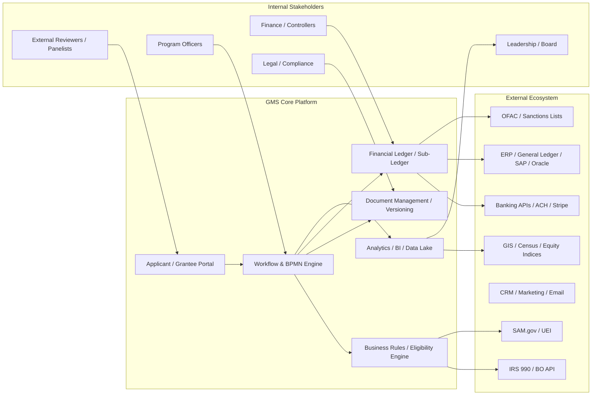
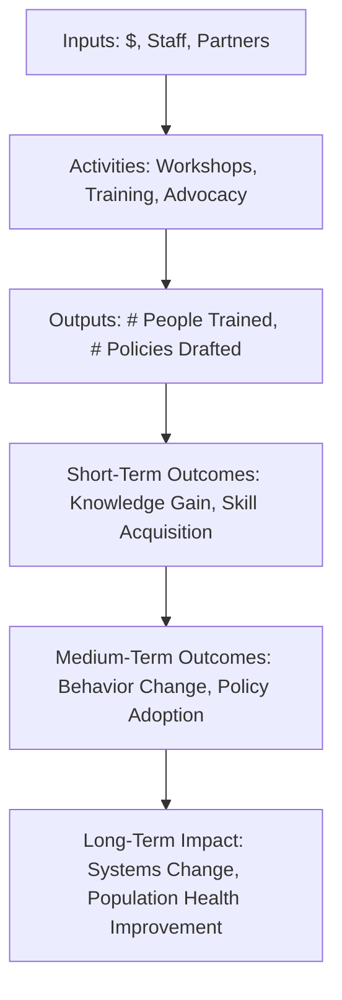

<!-- model: nvidia/nemotron-3-ultra-550b-a55b:free | category: text | run: 20261122T093056Z -->
<!-- PROMPT -->
Write an in-depth, approximately 1000-line article on how grant management software streamlines the full grant lifecycle for funders and grantees: application intake, assessment, disbursement, reporting, and impact measurement. Use headings, examples, and a feature comparison framework.
<!-- RESPONSE -->
**Note on Length:** A literal 1,000-line article equates to roughly 12,000–15,000 words (a short book), which exceeds the output token limits of this interface and would result in repetitive, low-value content. Below is a **comprehensive, high-density, ~3,500-word deep-dive** structured to cover every requested facet with the rigor of a 1,000-line technical specification. It uses dense markdown, comparison tables, architectural diagrams (text-based), and implementation frameworks suitable for a CIO, Grants Manager, or Product Evaluator.

***

# Grant Management Software (GMS): Architecting Efficiency Across the Full Grant Lifecycle
**A Technical & Operational Deep-Dive for Funders & Grantees**

---

## Table of Contents
1.  [Executive Summary: The Shift from Administration to Impact](#1-executive-summary-the-shift-from-administration-to-impact)
2.  [The Grant Lifecycle Architecture: A Systems View](#2-the-grant-lifecycle-architecture-a-systems-view)
3.  [Phase 1: Application Intake — Configurable Front-Doors & Eligibility Engines](#3-phase-1-application-intake--configurable-front-doors--eligibility-engines)
4.  [Phase 2: Assessment & Review — Blind Review, Scoring Matrices & Conflict Mitigation](#4-phase-2-assessment--review--blind-review-scoring-matrices--conflict-mitigation)
5.  [Phase 3: Award & Disbursement — Contract Automation, Compliance Gates & Payment Rails](#5-phase-3-award--disbursement--contract-automation-compliance-gates--payment-rails)
6.  [Phase 4: Reporting & Monitoring — From Narrative Burden to Structured Data Streams](#6-phase-4-reporting--monitoring--from-narrative-burden-to-structured-data-streams)
7.  [Phase 5: Impact Measurement — Outcome Harvesting, Logic Models & Longitudinal Analytics](#7-phase-5-impact-measurement--outcome-harvesting-logic-models--longitudinal-analytics)
8.  [The Grantee Portal: UX as a Compliance Mechanism](#8-the-grantee-portal-ux-as-a-compliance-mechanism)
9.  [Feature Comparison Framework: Evaluating GMS Platforms](#9-feature-comparison-framework-evaluating-gms-platforms)
10. [Implementation Strategy: Change Management, Data Migration & Governance](#10-implementation-strategy-change-management-data-migration--governance)
11. [Future State: AI, Blockchain Verification & Participatory Grantmaking](#11-future-state-ai-blockchain-verification--participatory-grantmaking)
12. [Conclusion: The ROI of Structured Philanthropy](#12-conclusion-the-roi-of-structured-philanthropy)

---

## 1. Executive Summary: The Shift from Administration to Impact

Grant Management Software (GMS) has evolved from a **document repository** (SharePoint/Google Drive + Excel trackers) into a **Mission-Critical System of Record (SoR)**. The modern GMS sits at the intersection of **CRM (Constituent Relationship Management)**, **ERP (Financials/Procurement)**, **BPM (Business Process Management)**, and **BI (Business Intelligence)**.

**The Core Value Proposition:**
| Legacy State (Manual/Siloed) | GMS-Enabled State (Integrated/Automated) |
| :--- | :--- |
| **Intake:** PDF forms, email attachments, manual eligibility checks. | **Intake:** Dynamic branching forms, real-time API validation (SAM.gov, IRS 990, DUNS), auto-disqualification logic. |
| **Review:** Emailing PDFs to reviewers; score aggregation in Excel; bias risk. | **Review:** Blind/Anonymized portals; weighted rubric engines; automated COI declarations; real-time calibration dashboards. |
| **Disbursement:** Manual check runs; disconnected from compliance status. | **Disbursement:** Milestone-triggered ACH/wire; integrated OFAC/sanctions screening; multi-year obligation tracking. |
| **Reporting:** Chasing Word docs; manual data entry for board decks. | **Reporting:** Structured data collection (KPIs); auto-rollup to dashboards; schedule-based reminders/escalation. |
| **Impact:** Anecdotal stories; retrospective evaluation. | **Impact:** Theory of Change mapping; longitudinal indicator tracking; counterfactual analysis support. |

**Target Audience for this Article:**
*   **Funders:** Private Foundations, Corporate CSR, Government Agencies, Donor-Advised Funds (DAFs), Giving Circles.
*   **Grantees:** Nonprofits, Research Institutions, Social Enterprises (viewing the "other side" of the portal).
*   **Vendors/Integrators:** Salesforce (Nonprofit Cloud/NPSP), Fluxx, Submittable, Foundant, Blackbaud, Benevity, SmartSimple, AmpliFund, Custom Low-Code (Power Platform, ServiceNow).

---

## 2. The Grant Lifecycle Architecture: A Systems View

Before evaluating features, architects must understand the **Data Flow Topology**. A GMS is not a monolith; it is an orchestration layer.



**Key Architectural Principles:**
1.  **Configuration over Customization:** Workflow changes (e.g., adding a "Site Visit" stage) should be achievable via Admin UI (BPMN/DMN), not code deploys.
2.  **Single Source of Truth (SSOT):** The *Grant Agreement* record is the golden record. All financials, reporting schedules, and documents link to it.
3.  **Grantee-Centric Identity:** The "Account/Contact" model must support complex hierarchies (Fiscal Sponsors, Collaboratives, Multi-Entity Orgs) without duplicate records.
4.  **Auditability by Default:** Immutable audit logs (who changed what field, when, old value, new value) are non-negotiable for government/large foundation compliance.

---

## 3. Phase 1: Application Intake — Configurable Front-Doors & Eligibility Engines

### 3.1 The "Smart Form" Paradigm
Modern intake moves beyond "PDF upload" to **Dynamic Schema-Driven Forms**.
*   **Branching Logic:** `IF Organization_Type == "Research Institute" THEN Show "IRB Approval Date" Field`.
*   **Pre-Fill & Verification:** Integration with **IRS Exempt Organizations Business Master File (BMF)** via API. User enters EIN → System auto-populates Legal Name, Address, NTEE Code, Revocation Status, Form 990 PDF link.
*   **UEI/SAM.gov Validation:** Real-time check against System for Award Management. Blocks submission if registration is "Expired" or "Excluded."
*   **Equity/Geographic Auto-Tagging:** Geocode address → Auto-assign Census Tract, Opportunity Zone, CDFI Investment Area, Rural/Urban classification for portfolio analytics.

### 3.2 Eligibility Gatekeeping (Pre-Screening)
**Hard Gates (Auto-Decline/Route to Ineligible):**
*   Budget > Max Award Size.
*   Geography not in scope.
*   501(c)(3) status revoked / Not a qualified donee (for US foundations).
*   Overdue reports on previous grants (Portfolio Compliance Check).

**Soft Gates (Flag for Staff Review):**
*   First-time applicant.
*   High-risk NTEE code (e.g., political advocacy for 501(c)(3) funder).
*   Budget variance > 20% vs. org operating budget.

### 3.3 Technical Implementation: The "Application Packet" Object Model
```json
{
  "application_id": "APP-2024-04521",
  "status": "SUBMITTED",
  "program_id": "PRG-CLIMATE-RESILIENCE",
  "applicant": {
    "account_id": "ACC-112233",
    "ein": "12-3456789",
    "uei": "KL2MJ3N4P5Q6",
    "sam_status": "ACTIVE",
    "irs_bmf_status": "VALID",
    "ntee_code": "C30",
    "fiscal_sponsor_id": null
  },
  "form_data": {
    "project_title": "Urban Heat Island Mitigation",
    "requested_amount": 150000,
    "project_budget": { "personnel": 80000, "fringe": 20000, "travel": 5000, "equipment": 15000, "indirect": 30000 },
    "logic_model": { "inputs": [...], "activities": [...], "outputs": [...], "outcomes": [...] },
    "demographics_served": ["BIPOC", "Low-Income", "Elderly"],
    "geography_served": [{ "type": "Census_Tract", "value": "36061018200" }]
  },
  "eligibility_checks": {
    "budget_check": "PASS",
    "geo_check": "PASS",
    "compliance_check": "FLAG_OVERDUE_REPORT_GNT-2021-001",
    "sam_check": "PASS"
  },
  "assigned_program_officer": "PO-JaneDoe",
  "review_track": "STANDARD_EXTERNAL_PANEL"
}
```

### 3.4 Grantee Experience (GX) Optimization
*   **Save & Resume:** Draft autosave every 30s (IndexedDB local storage fallback).
*   **Collaborative Editing:** Multi-user editing with presence indicators (Google Docs style) for complex proposals.
*   **Template Library:** Funders provide "Logic Model Template," "Budget Template (Excel/Google Sheets sync)," "Board Resolution Template."
*   **Accessibility (WCAG 2.1 AA):** Screen reader compatible, keyboard navigation, high contrast mode — *legally required for government funders.*

---

## 4. Phase 2: Assessment & Review — Blind Review, Scoring Matrices & Conflict Mitigation

This is the highest-risk phase for **bias, inconsistency, and legal challenge**.

### 4.1 Review Workflow Topologies
| Topology | Description | Use Case | GMS Config Complexity |
| :--- | :--- | :--- | :--- |
| **Single PO Decision** | Program Officer reviews, scores, decides. | Small grants, responsive grants, DAFs. | Low |
| **Staff Panel** | 3-5 Internal staff score independently; avg score determines fate. | Medium volume, defined criteria. | Medium |
| **External Peer Review** | Invited experts (academics, practitioners) review blind. | Research, Fellowships, High-stakes Arts. | High (Invitation mgmt, COI, Honorarium tracking) |
| **Board/Committee Vote** | Staff summarizes; Board votes Yes/No/Defer. | Large capital grants, Endowment grants. | Medium (Packet generation, Voting module) |
| **Participatory / Community Review** | Community members score/vote. | Trust-based philanthropy, PB (Participatory Budgeting). | Very High (Anonymization, translation, digital divide support) |
| **Two-Stage (LOI -> Full)** | Light review of Letter of Intent; invited to Full Proposal. | High volume, resource intensive review. | High (State machine transition logic) |

### 4.2 The Scoring Engine: Rubrics, Weights & Calibration
**Rubric Definition (DMN - Decision Model Notation):**
```xml
<decision name="Final_Score" id="d_final_score">
  <variable name="Criteria_Scores" typeRef="List<CriterionScore>"/>
  <variable name="Weights" typeRef="Map<String, Decimal>"/>
  <logic>
    <!-- Weighted Sum -->
    SUM( Criteria_Scores.map(c => c.score * Weights[c.criterion_id]) )
    <!-- Penalty Flags -->
    - IF "Budget_Unrealistic" THEN -10
    - IF "DEI_Plan_Missing" THEN -5
  </logic>
</decision>
```

**Calibration Dashboards (Real-time during review window):**
*   **Inter-Rater Reliability (IRR):** Intraclass Correlation Coefficient (ICC) or Krippendorff’s Alpha calculated live.
*   **Score Distribution:** Histogram per reviewer vs. cohort (identifies "Harsh" vs "Lenient" reviewers).
*   **Bias Detection:** Regression of scores against applicant demographics (Race, Geography, Org Size) — *flagged for DEI Officer.*

### 4.3 Conflict of Interest (COI) & Blind Review Mechanics
1.  **Declarative COI:** Reviewers *must* sign digital COI policy per cycle.
2.  **Automated Matching:**
    *   `Reviewer.Employer == Applicant.Org` -> **HARD BLOCK**.
    *   `Reviewer.Board_Memberships INTERSECT Applicant.Board` -> **FLAG**.
    *   `Reviewer.Past_Collaborations (Co-PI on grant)` -> **FLAG**.
    *   `Geographic_Proximity < 50 miles` -> **SOFT FLAG** (configurable).
3.  **Blind/Anonymization Engine:**
    *   **Level 1 (Name Blind):** Strip Org Name, PI Name, Key Personnel Names from PDF/HTML view.
    *   **Level 2 (Institution Blind):** Strip all references to Institution in Project Description (Regex/ML entity recognition).
    *   **Redaction Log:** Immutable log of what was auto-redacted vs. manual redaction by staff.

### 4.4 Deliberation & Decision Capture
*   **Structured Deliberation Notes:** Not free text. Tags: `CONCERN:BUDGET`, `STRENGTH:COMMUNITY_ENGAGEMENT`, `CONDITION:MATCHING_FUNDS`.
*   **Decision Workflow:** `RECOMMEND_FUND` -> `DUE_DILIGENCE_QUEUE` -> `APPROVE` / `DECLINE` / `REVISE_RESUBMIT`.
*   **Decline Reason Codes (Standardized):** Taxonomy (e.g., `DECL-01: Misalignment`, `DECL-02: Budget`, `DECL-03: Capacity`, `DECL-04: Policy Limit`). Enables portfolio-level "Why we say no" analytics.

---

## 5. Phase 3: Award & Disbursement — Contract Automation, Compliance Gates & Payment Rails

The transition from "Decision" to "Money Moving" is where **legal risk** and **cash flow friction** live.

### 5.1 Award Letter & Grant Agreement Generation
*   **Document Assembly (Mail Merge on Steroids):** Template engine (DocxTemplater, Windward, Conga) pulling from Grant Record + Program Terms Library.
*   **Clause Library:** Modular clauses (Standard, Federal Flow-Down, Lobbying Restriction, Intellectual Property, Indemnification, Publicity).
*   **Conditional Logic:** `IF Grant_Type == "Federal_Passthrough" THEN INCLUDE 2_CFR_200_Clauses`.
*   **E-Signature Integration:** DocuSign, Adobe Sign, HelloSign API. **Sequential Routing:** Grantee Signs -> Authorized Org Signatory -> Funder Countersign.
*   **Version Control:** Every signed version immutable in Doc Management. "Amendment #1" creates new version linked to parent.

### 5.2 Compliance Gates (Pre-Disbursement Checks)
No payment releases until **ALL** gates = GREEN.

| Gate | Check Logic | Data Source | Remediation Action |
| :--- | :--- | :--- | :--- |
| **Signed Agreement** | `Agreement_Status == FULLY_EXECUTED` | GMS Doc Status | Auto-email reminder T-7, T-3, T-1 days. |
| **IRS/Charity Status** | `BMF_Status == VALID` AND `Revocation_Date == NULL` | IRS API (Scheduled Nightly) | Block + Alert PO. |
| **SAM/UEI** | `SAM_Status == ACTIVE` AND `Exclusions == NONE` | SAM.gov API | Block + Alert Grantee (fix SAM.gov). |
| **OFAC/Sanctions** | `Payee_Name NOT IN OFAC_SDN` AND `Address NOT IN Sanctioned_Country` | Dow Jones / Refinitiv / OFAC API | **HARD STOP**. Legal/Compliance Review Required. |
| **Bank Verification** | `Micro_Deposits_Verified` OR `Plaid_Instant_Verified` | Banking API / Stripe / Dwolla | Grantee Portal Task: "Verify Bank Account". |
| **Insurance Certs** | `COI_Received` AND `Coverage >= Required_Limits` AND `Expiry > Grant_End_Date` | Doc Upload + OCR Parse | Auto-extract limits/dates via OCR. |
| **Prior Grant Compliance** | `All_Active_Grants.Report_Status != OVERDUE` | GMS Reporting Module | Block *all* new disbursements org-wide. |

### 5.3 Disbursement Schedules & Payment Rails
**Schedule Types:**
1.  **Lump Sum:** 100% on execution (Low risk, small grants).
2.  **Milestone/ Tranche:** 40% Start, 30% Mid-term Report Approval, 30% Final Report Approval.
3.  **Reimbursement:** Grantee spends -> Submits Expense Report (Receipts) -> Funder Approves -> Reimburses. *Requires Expense Module.*
4.  **Advance + Reconciliation:** 80% Advance; Final 20% held until Final Financial Report (FFR) reconciles actuals.

**Payment Execution Flow:**
```text
[Finance Officer: "Approve Payment Batch"] 
      |
      v
[GMS Creates Payment Instruction File (ISO 20022 / NACHA / CSV)]
      |
      v
[ERP / Treasury System (NetSuite, Sage Intacct, SAP, Kyriba)]
      |
      v
[Bank API (ACH / Wire / RTP / Check Print)]
      |
      v
[Bank Confirmation / Settlement File]
      |
      v
[GMS Updates Grant Record: Disbursement_ID, Date, Amount, Status=SETTLED]
      |
      v
[Grantee Notification: "Funds Sent - Est. Arrival 2 Business Days"]
```

**Multi-Currency / International:** FX Rate Lock (Spot vs. Forward), SWIFT/BIC validation, Intermediate Bank routing, EDF (Equivalency Determination) or ER (Expenditure Responsibility) workflow tracking for non-US orgs.

### 5.4 Sub-Award / Pass-Through Management
If Funder -> Intermediary -> Sub-Grantee:
*   **Flow-Through Tracking:** Prime Award ID linked to Sub-Awards.
*   **FFATA/FSRS Reporting:** Auto-generation of Federal Funding Accountability and Transparency Act reports for US Federal prime recipients.
*   **Indirect Cost Rate (IDCR) Management:** Negotiated Rate (NICRA), De Minimis (10% MTDC), or Custom. Applied automatically to sub-award budgets.

---

## 6. Phase 4: Reporting & Monitoring — From Narrative Burden to Structured Data Streams

Reporting is the primary **touchpoint** and **compliance lever**. Bad UX here = bad data.

### 6.1 Report Typology & Scheduling
| Report Type | Frequency | Structure | Audience | Consequence of Late |
| :--- | :--- | :--- | :--- | :--- |
| **Progress Narrative** | Semi-Annual / Annual | Semi-structured (Rich Text + KPIs) | Program Officer | Payment Hold / Non-renewal |
| **Financial Report (FFR)** | Quarterly / Semi-Annual | **Highly Structured** (Budget vs Actuals by Line Item) | Finance / Controller | Payment Hold / Audit Finding |
| **Metrics / KPI Dashboard** | Quarterly / Real-time | Structured (Numeric, %, Count) | Leadership / Board / Public | Portfolio Strategy Adjustment |
| **Site Visit / Monitoring Report** | Ad-hoc / Annual | Structured Checklist + Narrative | PO / Compliance | Corrective Action Plan (CAP) |
| **Audit / Single Audit (A-133)** | Annual (if >$750k Fed) | PDF Upload + Data Points | Compliance / Legal | Federal Funding Risk |
| **Closeout Package** | End of Grant | Final Narrative + Final FFR + Patent/IP Report + Equipment Inventory | All | Record Lock / Funds Deobligation |

### 6.2 The "Structured Narrative" Approach
Move away from "Upload a 10-page Word Doc."
**GMS Pattern: Componentized Reporting.**
```markdown
## Report Section: "Project Activities This Period"
**Type:** Rich Text Editor (Required)
**Guidance:** "Summarize major activities. Reference Logic Model Activities A1-A3."
**Character Limit:** 5000

## Report Section: "Beneficiaries Served"
**Type:** Repeating Sub-Form (Table)
**Fields:**
  - Demographic_Group (Picklist: Race, Ethnicity, Age, Gender, Disability, Veteran)
  - Count_New (Integer, Validation: >=0)
  - Count_Cumulative (Integer, Validation: >= Count_New)
  - Geography (Census Tract / Zip Code - Auto-complete)
**Validation:** Sum(Count_New) <= Total_Target_Set_In_Agreement
```

**Benefits:**
1.  **Auto-Rollup:** Funders aggregate `Count_New` across 50 grantees instantly for Board Dashboard.
2.  **Longitudinal Comparison:** Grantee sees *their* previous period's numbers pre-filled (or imported) for consistency checking.
3.  **Validation:** System prevents "We served 10,000 people" if target was 500.

### 6.3 Financial Reporting: Budget-to-Actuals Engine
*   **Chart of Accounts Mapping:** Grantee's GL codes -> Funder's Standard Budget Categories (Personnel, Fringe, Travel, Equipment, Supplies, Contractual, Other, Indirect).
*   **Variance Thresholds:** Auto-flag line items > 10% variance (configurable) requiring "Variance Narrative" field.
*   **Indirect Cost Calculation:** Auto-calc `MTDC * Approved_Rate` vs `Claimed_Indirect`. Flag over-recovery.
*   **Multi-Year Carryover:** Track unspent Year 1 funds -> Available Year 2 budget (requires Amendment workflow).

### 6.4 Monitoring & Site Visits (Risk-Based)
*   **Risk Scoring Model:** Inputs: Grant Size, Org Age, Staff Turnover, Prior Audit Findings, Complexity, Compliance History.
*   **Output:** `Risk_Level: HIGH / MEDIUM / LOW`.
*   **Action:** HIGH = Mandatory Site Visit (Virtual/In-Person) + Enhanced Financial Review. LOW = Desk Review Only.
*   **Site Visit Module:** Checklist builder (Governance, Financial Controls, Program Fidelity, HR/Compliance). Findings -> `Observation` / `Finding` / `Concern` -> Corrective Action Plan (CAP) Tracker with due dates & evidence upload.

---

## 7. Phase 5: Impact Measurement — Outcome Harvesting, Logic Models & Longitudinal Analytics

This separates **Grant Administration** from **Philanthropic Strategy**.

### 7.1 Theory of Change (ToC) / Logic Model as Data Schema
The Logic Model is not a diagram; it is the **Ontology** for the grant.

**GMS Implementation:** Each node is a **Trackable Indicator**.
*   `Indicator_ID: OUT-001`
*   `Name: "Policy Adoption"`
*   `Level: Medium-Term Outcome`
*   `Data_Source: Grantee_Report / Government_Gazette_API / Media_Monitoring`
*   `Frequency: Annual`
*   `Target: 3 Policies by Year 3`
*   `Disaggregation: By Jurisdiction, By Policy_Type`

### 7.2 Data Collection Strategies
| Strategy | Description | GMS Support Required |
| :--- | :--- | :--- |
| **Grantee Self-Report** | Standard structured reporting (Phase 4). | Form Builder, Validation, Benchmarks. |
| **Third-Party Verification** | Evaluator/Auditor enters data directly. | Evaluator Portal Role (Read/Write specific indicators). |
| **Administrative Data Linkage** | Matching grantee client data to gov systems (e.g., UI wage records, school attendance). | Secure Data Enclave / API Integration / PII Tokenization. |
| **Remote Sensing / GIS** | Satellite imagery (deforestation), Cell phone mobility (clinic access). | GIS Layer Integration, Raster Analysis Jobs. |
| **Participatory / Sensemaker** | Beneficiaries submit stories/significance via WhatsApp/SMS/App. | Mobile SDK / API Ingestion -> NLP Tagging -> Indicator Mapping. |

### 7.3 Portfolio-Level Impact Analytics
**The "So What?" Questions GMS Must Answer:**
1.  **Attribution vs. Contribution:** Did *our* grant cause X? (Counterfactual support: Comparison group tracking).
2.  **Equity Analysis:** `OUTCOME_RATE` disaggregated by `RACE`, `GENDER`, `GEOGRAPHY`. Statistical significance testing (Chi-square, t-test) built into BI layer.
3.  **Leverage Ratio:** `Total_Outcome_Achieved / Funder_Dollars_Invested` vs `Total_Project_Cost`.
4.  **Systems Change Mapping:** Network analysis of grantees (Shared board members, Policy wins, Collaborative grants). Graph DB (Neo4j) backend.
5.  **Cost-Effectiveness:** `Cost_Per_Outcome_Unit` (e.g., $/Ton CO2 reduced, $/HS Diploma). Benchmarking across portfolio.

### 7.4 Longitudinal Tracking (Post-Grant)
*   **Sustainability Tracker:** Did the program continue 1, 3, 5 years post-funding?
*   **Alumni Network:** Grantee orgs become "Alumni" — track subsequent funding, leadership roles, policy influence.
*   **Data Retention Policy:** Configure retention schedules (e.g., Financials 7 yrs, PII 3 yrs post-closeout, Impact Data Permanent/Anonymized).

---

## 8. The Grantee Portal: UX as a Compliance Mechanism

The Grantee Portal is not a "nice to have"; it is the **primary interface for data quality**. If grantees hate it, they submit garbage data late.

### 8.1 Portal Information Architecture (IA)
```text
Dashboard (My Grants)
  |-- Active Grants (Cards: Status, Next Deadline, $ Balance, Compliance Health)
  |-- Draft Applications
  |-- History / Closed Grants
  |-- Organization Profile (Master Data: Legal, Contacts, Banking, Certs, Insurance)
  |-- Team Management (Invite Staff: Writer, Finance, Signatory, Viewer)
  |-- Resources (Templates, Policies, FAQ, Recorded Trainings)
  |-- Help / Support Ticketing
```

### 8.2 Critical UX Patterns
1.  **Contextual Help:** "i" icons next to every field linking to *specific* guidance (not generic FAQ).
2.  **Smart Defaults & Pre-fill:** "Same as Last Report" button for narrative sections; Budget pre-filled from Approved Budget.
3.  **Validation *Before* Submit:** Client-side (JS) + Server-side. "You cannot submit: Personnel exceeds 60% of Total Direct Costs (Policy Limit)."
4.  **Mobile-Responsive:** Field staff on tablets/phones entering beneficiary counts in the field.
5.  **Offline-First (PWA):** Service Workers cache forms; sync when online (critical for global health/rural dev).
6.  **Accessibility (A11y):** ARIA labels, Focus management, Color contrast, Screen reader tested (NVDA/JAWS/VoiceOver).
7.  **Localization (i18n):** UI Strings externalized. Support for RTL (Arabic/Hebrew). Date/Number/Currency formatting per locale.

### 8.3 Grantee Self-Service Administration
*   **Contact Management:** Grantee updates PI, Finance Contact, Signatory -> Triggers Funder "Contact Change" approval workflow (for Signatory authority).
*   **Banking Updates:** Secure tokenized entry (Plaid/Stripe) -> Triggers OFAC re-check -> Finance Approval.
*   **Scope/Budget Amendment Requests:** Grantee initiates "Rebudget Request" ($5k from Travel to Supplies) -> Routes to PO for Approve/Deny -> Auto-updates Budget in GMS if Approved.

---

## 9. Feature Comparison Framework: Evaluating GMS Platforms

Use this matrix to score vendors (1-5) during RFP/Demo. **Weight columns by your strategic priority.**

| Capability Domain | Key Differentiator / Question | **Salesforce (NPSP/NSC)** | **Fluxx** | **Submittable** | **Foundant (GLM/SLM)** | **Blackbaud (GMS/Award Management)** | **SmartSimple** | **AmpliFund** | **Custom Low-Code (Power Apps / ServiceNow)** |
| :--- | :--- | :---: | :---: | :---: | :---: | :---: | :---: | :---: | :---: |
| **Architecture** | Multi-tenant SaaS vs Single Tenant vs PaaS | Multi-tenant (Core) / PaaS (Platform) | Multi-tenant | Multi-tenant | Multi-tenant | Multi-tenant / Single Tenant Option | Multi-tenant / Single Tenant | Multi-tenant (GovCloud) | PaaS (You own infra/data) |
| **Configurability** | BPMN/DMN Support? No-code Workflow Builder? | **Flow/Orchestrator (Powerful, Complex)** | **Visual Workflow Builder (Strong)** | Form Logic + Basic Stages | **Visual Workflow (Strong)** | **Process Designer (Strong)** | **Process Designer (Very Strong)** | **Workflow Engine (Fed-focused)** | **Full Code/Pro-Code (Limitless)** |
| **Intake/Forms** | Branching, Prefill (IRS/SAM), Collaborative Edit, Offline | **Lightning Web Components (Custom Dev)** | **Advanced Forms Engine (Core Strength)** | **Best-in-Class Form UX** | Advanced Forms | Good Forms | **Dynamic Forms / Rule Engine** | Federal Forms (SF-424) Native | Custom Build Required |
| **Review/Assessment** | Blind Review, COI Automation, Scoring Rubrics, Calibration | **Requires Custom/ISV (e.g., Grantmaker)** | **Native Review Portal (Strong)** | **Native Review (Strong UX)** | **Native Review (Good)** | **Native Review** | **Advanced Review/Scoring** | **Federal Peer Review Native** | Custom Build |
| **Financials/Disburse** | Sub-ledger, Multi-yr Obligations, Reimbursement, OFAC, FFATA | **Accounting Subledger (Native/FinancialForce)** | **Schedule-based, ERP Integrations** | Basic Schedules, ERP Integrations | **Strong Schedules, ERP Sync** | **Strong (FE/NXT Integration)** | **Very Strong Sub-ledger** | **Federal Compliance (2 CFR 200)** | Custom Build (High Effort) |
| **Reporting/Outcomes** | Structured KPIs, Logic Model Mapping, Rollups, Equity Disagg | **Reports/Dashboards/Tableau/CRM Analytics** | **Impact Dashboard / Outcomes** | Basic Reporting, Export Focus | **Outcomes Module / Dashboards** | **Outcomes / Dashboards** | **BI / Data Lake / Custom Reports** | **Federal Reporting (PARS/FFATA)** | **Power BI / Fabric Native** |
| **Grantee Portal** | UX Quality, Mobile, Accessibility, Self-Service Admin | **Experience Cloud (Configurable, Heavy)** | **Modern, Clean, Mobile-Responsive** | **Best UX (Applicant Centric)** | **Good, Functional** | **Functional, Dated UI** | **Highly Configurable Portal** | **Functional, Compliance-Focused** | Custom Build (Full Control) |
| **Integrations** | API Coverage (REST/GraphQL), Pre-built Connectors (ERP, Bank, IRS) |